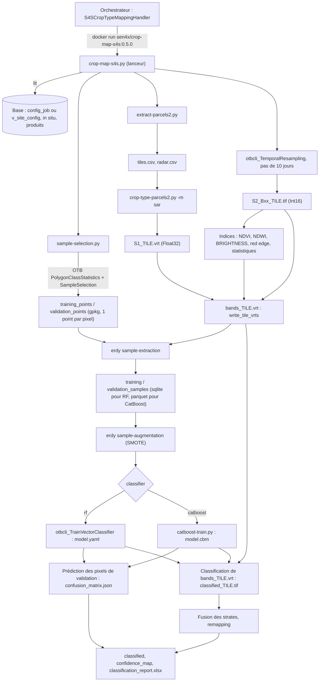

# Étape 1 — Le classifieur Sen4Stat (`crop-map-s4s.py`, image 0.5.0)

Lecture du code réel, sans modification. Les références de lignes renvoient à
[`upstream/crop-map-s4s-0.5.0/crop-map-s4s.py`](../upstream/crop-map-s4s-0.5.0/crop-map-s4s.py)
sauf mention contraire.

## 1. Provenance

| Élément | Valeur |
|---|---|
| Image | `sen4x/crop-map-s4s:0.5.0`, id `8c3acf3d9a33`, créée le 14/01/2026 |
| Base | image GDAL 3.3.2 (Ubuntu 20.04, déduit de `libpython3.8` et `libgeos-3.8.0`) |
| Python | 3.8 ; numpy 1.17.4, psycopg2 2.8.4, lxml, toml, xlsxwriter, `osgeo`, SDK `docker` 5.0.3 |
| Absents | scikit-learn, CatBoost, OTB, pandas, rasterio |
| Point d'entrée | aucun (`CMD ["bash"]`), utilisateur `root` |
| Scripts | 7 fichiers copiés dans `/usr/local/bin`, extraits le 13/10/2026, empreintes SHA-256 vérifiées après transfert |
| Métadonnées | `docker image inspect` et `docker image history` dans [`image/`](../upstream/crop-map-s4s-0.5.0/image/) |

| Script | Lignes | Rôle |
|---|---|---|
| `crop-map-s4s.py` | 3465 | Script principal : features, entraînement, classification |
| `sample-selection.py` | 924 | Sélection des polygones et pixels d'entraînement / validation |
| `crop-type-parcels2.py` | 1816 | Appelé en mode `sar` pour les features S1 |
| `product-report.py` | 364 | Rapport `classification_report.xlsx` |
| `export-product.py`, `export-product-launcher.py`, `import-product-details.py` | — | Non lus (export des produits, hors classification) |

## 2. Architecture : un conteneur lanceur et des conteneurs de calcul

Le conteneur `crop-map-s4s` ne calcule presque rien lui-même. Il interroge la
base, écrit des VRT, puis lance d'autres conteneurs avec le SDK Docker
(`ContainerInfo.run`, l. 335-383). Il accède au démon Docker de l'hôte par la
socket `/var/run/docker.sock`, montée par l'orchestrateur (vérifié sur un job
réel, §10).

| Image | Utilisation |
|---|---|
| `sen4x/processors-new:0.4.1` | Rééchantillonnage temporel S2 (`otbcli_TemporalResampling`), indices (`S4SCMSpectralIndices`, `S4SCMRedEdgeFeatures`, `S4SCMSpectralIndicesStatistics`), `ClassRemapping` |
| `orfeotoolbox/otb:8.1.1` | RF : `TrainVectorClassifier`, `VectorClassifier`, `ImageClassifier` ; sélection des pixels (`PolygonClassStatistics`, `SampleSelection`) |
| `sen4x/otb:6.6.1` | Idem RF si `--use-old-otb` (modèles > 2 Go) |
| `lnicola/erdy:0.2.5` | Extraction des échantillons, SMOTE, prédiction CatBoost, matrices de confusion, fusion des strates |
| `sen4x/catboost:0.1.0` | Entraînement CatBoost (`catboost-train.py`) |
| `sen4x/s4s-interim-ct:0.2.0` | `extract-parcels2.py` : emprises des tuiles et liste des produits radar |
| `sen4cap/processors:3.0.0`, `sen4x/processors-new:0.3.0` | Utilisées par `crop-type-parcels2.py` (S1) |

Montages passés aux conteneurs de calcul (l. 2168-2186) :

- `/mnt/archive` (lecture-écriture), codé en dur ;
- `/etc/sen2agri/sen2agri.conf` (lecture seule) ;
- le répertoire de travail du job (lecture-écriture) ;
- chaque paire `source:cible` de la clé **`general.orchestrator.docker_add_mounts`**
  (globale, liste séparée par des virgules, lecture seule) ;
- chaque chemin passé en `--mounts` (lecture seule).

## 3. Schéma du flux



## 4. Lecture de la configuration

Trois sources :

1. **Arguments en ligne de commande** transmis par l'orchestrateur (l. 2012-2128) :
   `--site-id`, `--season-start`, `--season-end`, `--features`, `--pix-min`,
   `--pix-best`, `--pix-ratio-*`, `--poly-min`, `--smote-ratio`,
   `--sample-ratio-*`, `--monitored-*`, `--remapping-set-id`, `--tiles`,
   `--mounts`, `--working-path`, `--output-path`, `--job-id`, etc.
2. **`/etc/sen2agri/sen2agri.conf`** : connexion à la base. `localhost` est
   remplacé par `172.17.0.1` (passerelle Docker), l. 62-64.
3. **La base**, dans `load_processor_config` (l. 468-518) :
   - avec `--job-id` : `sp_get_job_parameters(job_id)`, c'est-à-dire les lignes
     de `config_job` du job ;
   - sans : `v_site_config` pour le site.

   Clés lues : `processor.s4s_crop_mapping.classifier`, `.rf.max-depth`,
   `.rf.min-samples`, `.rf.num-trees`, `.catboost.iterations`, `.catboost.depth`,
   `.catboost.early-stopping-rounds`, `.catboost.test-split`,
   `.catboost.random-state`, et `general.orchestrator.docker_add_mounts`.

**L'hypothèse du cadrage est confirmée** : le classifieur et ses
hyperparamètres ne passent pas par la ligne de commande, le script les lit en
base à partir de `--job-id`.

## 5. Sélection des pixels d'entraînement (`sample-selection.py`)

- **Données in situ** : tables `in_situ_polygons_{site}_{saison}`,
  `polygon_attributes_{site}_{saison}`, `in_situ_data_{site}_{saison}`, et les
  rasters de référence `*_10m.tif` par tuile du dossier `processor.insitu.path`.
- **Polygones éligibles** (l. 490-529) : géométrie valide, non multipartie, sans
  chevauchement, `tile_id` renseigné, `pix_10m >= pix-min`, filtres sur les
  classes suivies, strate. Chaque polygone est **érodé de 10 m**
  (`ST_Buffer(-10)`).
- **Stratégies par culture**, selon la part de pixels de la culture
  (`pixel_ratio`) :

  | Stratégie | Condition | Part des pixels en entraînement |
  |---|---|---|
  | 1 | `pixel_ratio >= pix-ratio-hi` (5 %) | `sample-ratio-hi` (25 %) |
  | 2 | `>= pix-ratio-lo` (1 %) | `sample-ratio-lo` (75 %) |
  | 3 | sinon | 75 % + SMOTE jusqu'à `smote-ratio × total` |
  | 4 | polygone `< pix-best` pixels | validation uniquement |

- **Partage entraînement / validation par polygone** : les polygones sont pris
  dans un ordre aléatoire (`order by random()`, l. 563) et versés en entraînement
  jusqu'à atteindre la cible de pixels de leur culture ; les suivants vont en
  validation.
- **Pixels** : OTB `SampleSelection -strategy all` sur la grille du raster de
  référence, donc **tous les pixels** des polygones retenus, un point par pixel
  (`training_points_TILE.gpkg`).

## 6. Construction des features

`FeatureSet.parse` (l. 274-332) traduit `--features` en indicateurs. Sans
filtre, le jeu par défaut est : bandes S2 B3, B4, B8, B5, B6, B7, B11, B12 (pas
B2), indices, statistiques d'indices et S1.

| Jeton | Features |
|---|---|
| `sr10` | B2, B3, B4, B8 |
| `sr20` | B5, B6, B7, B11, B12 (rééchantillonnées à 10 m, cubique) |
| `vi` | NDVI, NDWI, BRIGHTNESS |
| `vis` | min, max, moyenne, médiane, écart-type de ces 3 indices |
| `re` | NDRE, REPI, PSRI, CIRE |
| `lai`, `fapar`, `fcover` | produits L3B |
| `sar` | features S1 de `crop-type-parcels2.py` |
| `-jeton` | retire la famille |

Un jeton inconnu est **ignoré sans erreur** : `tessera` passé au script 0.5.0
ne casse rien, mais ne fait rien.

**Format** : chaque série S2 est rééchantillonnée tous les 10 jours entre la
première et la dernière date L2A de la saison (l. 2314-2338), en Int16
(réflectance × 10 000, nodata −10 000). Les features S1 sont en Float32.

**Ordre des bandes** dans `bands_[STRATE_]TILE.vrt` (`write_tile_vrts`,
l. 892-1214), qui est aussi l'ordre des champs des échantillons et des
features du modèle :

1. Pour chaque type, dans l'ordre S2_B02, S2_B03, S2_B04, S2_B08, S2_B05,
   S2_B06, S2_B07, S2_B11, S2_B12, NDVI, NDWI, BRIGHTNESS, NDRE, REPI, PSRI,
   CIRE, LAI, FAPAR, FCOVER : une bande par date, nommée `TYPE_AAAA_MM_JJ`.
2. Statistiques : `NDVI_MIN` … `BRIGHTNESS_STDDEV` (15 bandes).
3. Features S1, sous leur nom d'origine (par exemple `S1_M…_BCK_…`), limitées à
   celles communes à toutes les tuiles.

Le VRT fait 10 980 × 10 980 pixels, dans l'EPSG de la tuile, avec la
géotransformation tirée de `shape_tiles_s2` (`geotransform_for_tile`,
l. 521-523). Les noms passent en minuscules comme noms de champs.

## 7. Entraînement, validation, prédiction

| Étape | RF (`rf`) | CatBoost (`catboost`) |
|---|---|---|
| Échantillons | `erdy sample-extraction` → `.sqlite` | idem → `.parquet` |
| Augmentation | `erdy sample-augmentation` (SMOTE), stratégie 3 | idem |
| Entraînement | `otbcli_TrainVectorClassifier -classifier rf` | `catboost-train.py` (image `sen4x/catboost`) |
| Validation | `otbcli_VectorClassifier` sur les pixels de validation | `erdy vector-predict` |
| Classification | `otbcli_ImageClassifier` sur `bands_TILE.vrt`, + carte de confiance | `erdy raster-predict` |

Puis : `erdy compute-confusion-matrix` (rappel, précision, F1 par classe),
remapping éventuel des classes, fusion des strates par masque, et
`product-report.py` qui produit `classification_report.xlsx`.

Un modèle est entraîné **par strate** (`model_STRATE.yaml` ou `.cbm`), sur les
échantillons de toutes les tuiles de la strate.

## 8. Points d'insertion pour TESSERA

| # | Où | Quoi |
|---|---|---|
| P1 | `FeatureSet` (l. 125-332) | Ajouter le jeton `tessera` et l'indicateur associé, faux par défaut : sans le jeton, le traitement reste identique. |
| P2 | `main`, après les features S2/S1 et avant `write_tile_vrts` (vers l. 3220) | Nouvelle fonction qui produit `TESSERA_TILE.tif` dans le répertoire de travail, aligné sur la grille de la tuile (EPSG, géotransformation, 10 980 × 10 980). C'est le prototype de l'étape 3. Données disponibles à cet endroit : `tiles` (géométrie, EPSG), `season_start` et `season_end` (choix de l'année). |
| P3 | `write_tile_vrts` (l. 892-1214) | Ajouter les bandes `TESSERA_000` … `TESSERA_127`, sans date, sur le modèle du bloc S1 (l. 1170-1204). |
| P4 | `load_processor_config` (l. 468-518) | Lire les clés `processor.s4s_crop_mapping.tessera-*` (chemin, version, année, dimensions). |
| P5 | Montages | `/eodata` doit être visible du conteneur lanceur, où P2 s'exécute. Si `TESSERA_TILE.tif` est écrit dans le répertoire de travail, les conteneurs de calcul n'ont pas besoin de `/eodata`. |
| — | Extraction, entraînement, classification | Aucun changement prévu : ces fonctions travaillent sur la liste des noms de bandes, pour RF comme pour CatBoost. |

## 9. Observations et hypothèses

1. **Partage non reproductible.** `order by random()` n'est pas initialisé : deux
   exécutions donnent des jeux d'entraînement et de validation différents. Pour
   comparer avec et sans TESSERA (étapes 4 et 7), il faudra garder les mêmes
   points. L'option `--keep-polygons` saute la sélection et réutilise les
   fichiers existants du répertoire de travail.
2. **`features-filter`** est stocké en base avec des virgules
   (`sr10,sr20,vi,vis,re`), et l'orchestrateur le découpe en jetons séparés
   pour `--features` (vérifié, §10).
3. **Clé de montage.** Le script ne lit que la clé globale
   `general.orchestrator.docker_add_mounts`. La clé
   `general.orchestrator.s4s-crop-type-mapping.docker_add_mounts` du cadrage
   n'existe pas en v4.0. L'orchestrateur applique aussi la clé globale au
   conteneur lanceur : `/eodata` et `/mnt/scratch` y sont montés (vérifié, §10).
4. **Clés en mode job.** Avec `--job-id`, seules les clés copiées dans
   `config_job` à la création du job sont visibles. Sur `eostat-12m`, cette
   table contient une copie complète de la configuration (497 clés) : de
   futures clés `tessera-*` y figureraient. À revérifier sur une instance v4.0.
5. **CatBoost avec strates.** Les noms des échantillons sont écrits en `.sqlite`
   pour les strates (l. 1247-1252) mais recherchés avec l'extension `.parquet`
   (l. 1315-1316). Hypothèse : CatBoost avec plusieurs strates ne trouve pas
   ses échantillons. Non testé, hors périmètre.
6. **Ordre des features S1.** Il vient d'un ensemble Python (l. 2354), donc
   peut varier d'une exécution à l'autre ; contrairement aux bandes S2, aucun
   contrôle (`assert`) ne vérifie la correspondance entre nom et position. Pour
   TESSERA, l'ordre devra être fixe et contrôlé.
7. **`geotessera`** est exclu dans cette image (Python 3.8). La lecture directe
   des `.npy` avec numpy 1.17 est possible.
8. **Volume.** Pour une saison de 6 mois, le jeu par défaut compte de l'ordre de
   250 features (estimation : 19 dates × 11 séries + 15 statistiques + S1).
   128 dimensions TESSERA ajoutent environ 50 %.
9. **Chemin in situ.** Le script ne remplace que `{site}` et `{season}` dans
   `processor.insitu.path` (`sample-selection.py`, l. 406-407). La v4.0 utilise
   `/mnt/archive/insitu/{site}/{season}` (`09.config.sql`, l. 755), mais une
   instance plus ancienne peut avoir `{year}` (cas de `eostat-12m`).

## 10. Vérification sur un job réel

Job 43193 de `eostat-12m` (installation antérieure à la v4.0, image `0.3.0`) :
site 91 (`wallonia_24`), saison du 01/01/2024 au 31/12/2024. Paramètres lus
dans les tables `config_job` et `step` le 13/10/2026.

Commande du conteneur lanceur (table `step`), chemins de travail abrégés :

```
docker run --rm -u 1002:1007 --group-add 994
  -v /var/run/docker.sock:/var/run/docker.sock
  -v /eodata:/eodata -v /mnt/scratch:/mnt/scratch
  -v /mnt/scratch/orchestrator_temp/s4s_crop_mapping:/mnt/scratch/orchestrator_temp/s4s_crop_mapping
  -v /mnt/archive:/mnt/archive -v /etc/sen2agri:/etc/sen2agri
  -v /etc/sen2agri/sen2agri.conf:/etc/sen2agri/sen2agri.conf
  -v /mnt/data/archive:/mnt/data/archive
  sen4x/crop-map-s4s:0.3.0 crop-map-s4s.py -s 91
  --season-start 2024-01-01 --season-end 2024-12-31
  --working-path …/43193/205938-s4s-crop-type-mapping/
  --output-path …/43193/205939-product-formatter/
  --remapping-set-id 1 --features sr10 sr20 vi vis re
```

Constats :

- la socket Docker est montée et le groupe `994` ajouté : c'est ainsi que le
  lanceur démarre les conteneurs de calcul, sous le même utilisateur `1002:1007` ;
- `general.orchestrator.docker_add_mounts` vaut
  `/eodata:/eodata,/mnt/scratch:/mnt/scratch` : `/eodata` est déjà monté dans le
  lanceur, et le script le transmet aux conteneurs de calcul ;
- `--features` reçoit des jetons séparés ;
- cet orchestrateur ancien ne transmet **ni `--job-id`, ni les paramètres
  `--pix-*`, `--smote-ratio`, `--sample-ratio-*`**. Avec le script 0.5.0, la
  configuration serait alors lue dans `v_site_config` et les autres paramètres
  prendraient leurs valeurs par défaut (hypothèse) ;
- `config_job` ne contient ni `classifier` ni `catboost.*` : version antérieure
  à CatBoost.

Le comportement de l'orchestrateur v4.0 reste à vérifier de la même façon sur
une instance v4.0.
